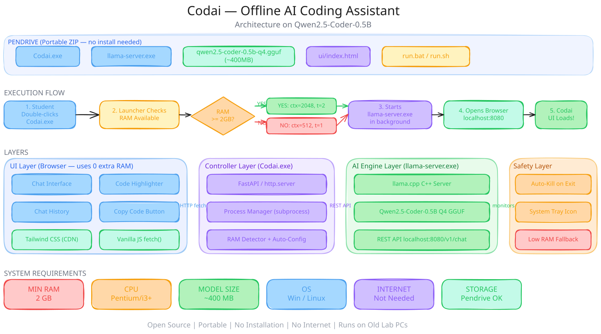

# 🚀 Codai Pro v3.1 - Offline AI Coding Assistant

<div align="center">


[](https://github.com/Luckyyaduvanshiofficial/Codaipro)
[](https://github.com/Luckyyaduvanshiofficial/Codaipro)
[](https://github.com/Luckyyaduvanshiofficial/Codaipro)

**🌟 A private, offline AI coding assistant with a native desktop app and the official llama.cpp engine**

*Built for lab exams, coding competitions, and any room where the network is off limits*

[📥 Download Latest Release](https://github.com/Luckyyaduvanshiofficial/Codaipro/releases/latest) • [🌐 Website](https://luckyyaduvanshiofficial.github.io/Codaipro/) • [📖 Model Guide](https://luckyyaduvanshiofficial.github.io/Codaipro/#download)

</div>

---

## What changed in v3.1

Codai Pro now has a **native Windows app**. It opens in its own window with a ChatGPT-style interface — conversation history, streaming answers, markdown with syntax-highlighted code, a stop button, and light/dark themes — instead of a browser tab. The installer **ships with the default model**, so the first launch only has to load it: no download and no model hunting before you can start.

Under the hood the local API is locked down: every request needs a per-session token, the `Host` header is validated against loopback to block DNS rebinding, and the wildcard CORS policy is gone. The engine also recovers from crashes instead of stalling.

See [CHANGELOG.md](CHANGELOG.md) for the full list.



## ✨ Why Codai Pro?

- **100% Offline** — inference happens on your CPU; nothing leaves the machine
- **Real desktop app** — native window, tray icon, no terminal and no browser tab
- **Real llama.cpp engine** — `llama-server` with streaming, not a Python wrapper
- **Model included** — the Windows installer ships the default model, so there is nothing to download
- **Self-healing** — engine health monitor, auto-restart, stale lock recovery, crash reports
- **Hardware-aware** — RAM/CPU tiers tune context size and threads automatically
- **Portable option** — one folder on a USB stick; `run.bat` does everything

## 🚀 Quick Start (Windows)

**Installer (recommended)**

```text
1. Download CodaiPro_Setup_3.1.0.exe from the releases page and run it
2. The one-click installer extracts and launches Codai Pro automatically
3. Wait while it loads the bundled model (a few seconds)
4. Chat
```

**Portable (no install)**

```text
1. Download the portable zip and unzip to a writable folder
2. Double-click run.bat
3. Wait for [READY] - your browser opens http://127.0.0.1:8081/
4. Press any key in the launcher window to stop Codai safely
```

Both packages include `Codai.exe` and the official `engine\llama-server.exe`. The
installer also bundles the default model. If a model is missing, the first run
downloads it; you can also drop any `.gguf` into `models/` yourself.

Full instructions and troubleshooting: [INSTALLATION.md](INSTALLATION.md).

## 🐍 Run from Source (Windows / Linux / macOS)

```bash
git clone https://github.com/Luckyyaduvanshiofficial/Codaipro.git
cd Codai

pip install -r requirements.txt   # just psutil

# Windows
run.bat

# Linux / macOS
python dev/controller.py
```

From source you also need the engine binary in `engine/`:

- **Windows**: `winget install llama.cpp`, then copy `llama-server.exe` into `engine\` — or grab `llama-bXXXX-bin-win-cpu-x64.zip` from [llama.cpp releases](https://github.com/ggml-org/llama.cpp/releases)
- **Linux**: download `llama-bXXXX-bin-ubuntu-x64.tar.gz` from [llama.cpp releases](https://github.com/ggml-org/llama.cpp/releases) and put `llama-server` (+ the `.so` files) into `engine/`
- **macOS**: use the llama.cpp release binaries or `brew install llama.cpp`, then symlink `llama-server` into `engine/`

## 🧠 Downloading a Model

Codai Pro runs a local GGUF model. The Windows installer includes the default **Qwen3.5-0.8B**. If the model is missing, the app downloads it using `model_url` in `config.json`. To use another model, either drop the `.gguf` into `models/` and set `"model_name"`, or set both `"model_name"` and `"model_url"` and let the app fetch it.

**Weak lab PC? Take a tiny one — under 1 GB, runs on almost anything:**

| Model | Size | Direct download (Q4_K_M) |
|-------|------|--------------------------|
| **Qwen3.5-0.8B** (default) | 0.58GB | [Download](https://huggingface.co/unsloth/Qwen3.5-0.8B-GGUF/resolve/main/Qwen3.5-0.8B-Q4_K_M.gguf) · [Model page](https://huggingface.co/unsloth/Qwen3.5-0.8B-GGUF) |
| Gemma 3 1B Instruct | 0.81GB | [Download](https://huggingface.co/bartowski/google_gemma-3-1b-it-GGUF/resolve/main/google_gemma-3-1b-it-Q4_K_M.gguf) · [Model page](https://huggingface.co/bartowski/google_gemma-3-1b-it-GGUF) |
| Qwen3-0.6B | 0.48GB | [Download](https://huggingface.co/bartowski/Qwen_Qwen3-0.6B-GGUF/resolve/main/Qwen_Qwen3-0.6B-Q4_K_M.gguf) · [Model page](https://huggingface.co/bartowski/Qwen_Qwen3-0.6B-GGUF) |
| Llama 3.2 1B Instruct | 0.81GB | [Download](https://huggingface.co/bartowski/Llama-3.2-1B-Instruct-GGUF/resolve/main/Llama-3.2-1B-Instruct-Q4_K_M.gguf) · [Model page](https://huggingface.co/bartowski/Llama-3.2-1B-Instruct-GGUF) |

The Qwen 3 family thinks before it answers; the engine keeps the scratchpad out of your way.

**When 2 GB is fine — a better coder:**

| Model | Size | Best For | Source |
|-------|------|----------|--------|
| **Phi-3.5-mini** ⭐ | 2.3GB | Best speed/quality balance | [microsoft/Phi-3.5-mini-instruct-gguf](https://huggingface.co/microsoft/Phi-3.5-mini-instruct-gguf) |
| **Qwen2.5-Coder-3B** | 2GB | Fast coding on low-spec machines | [Qwen/Qwen2.5-Coder-3B-Instruct-GGUF](https://huggingface.co/Qwen/Qwen2.5-Coder-3B-Instruct-GGUF) |
| **Qwen2.5-Coder-7B** | 4.7GB | Most powerful (q4_k_m) | [Qwen/Qwen2.5-Coder-7B-Instruct-GGUF](https://huggingface.co/Qwen/Qwen2.5-Coder-7B-Instruct-GGUF) |

- Pick the **q4** / **q4_k_m** quantization for the best CPU performance.
- If a model downloads as split parts, keep all parts together in `models/`.
- Chat templates are applied by the engine from the model metadata — every model above just works.

## 🏗️ Architecture

```text
Codaipro/
├── dev/
│   ├── config.py       # config, constants, paths, env overrides
│   ├── controller.py   # orchestrator: lifecycle, logging, shutdown
│   ├── downloader.py   # resumable model download
│   ├── engine.py       # llama-server process + health monitor + restart
│   ├── proxy.py        # auth, Host checks, streaming, telemetry
│   └── system.py       # hardware analysis (RAM/CPU tiers)
├── desktop/            # Electron app (window, tray, chat UI)
│   ├── src/main/       # main process: runtime, chat IPC, storage
│   ├── src/preload/    # narrow bridge exposed to the renderer
│   └── src/renderer/   # chat interface (HTML/CSS/JS, no build step)
├── engine/             # llama-server binary (downloaded, not in git)
├── models/             # .gguf models (not in git)
├── ui/                 # browser chat UI used by the portable build
├── tests/              # Python test suite
├── config.json         # port, model name, model URL, debug
├── build-windows.ps1   # one-command Windows build
├── run.bat             # portable launcher
└── kill.bat            # force-clean processes and locks
```

- **Desktop shell** starts the Python runtime as a sidecar on a reserved pair of free ports, waits for readiness, then opens the chat window. It passes the port and session token to the renderer over IPC; the renderer never touches Node or the network directly.
- **Controller** starts the proxy, boots the engine, tracks lifecycle phases, performs graceful shutdown.
- **Proxy** authenticates every API call, validates the `Host` header, and forwards `/v1/chat/completions` to the engine with request IDs, queue control, and SSE streaming.
- **Engine manager** validates the binary and bundled VC++ runtime, downloads the model if needed, waits until the model can actually answer, monitors health every 5s, and restarts up to 3 times.
- **Preflight checks** verify the runtime, engine, model, disk space, and available memory before the window opens, with a recovery dialog instead of a blank screen.

The browser UI (`ui/`) still ships for the portable build. The desktop app has its own renderer and does not open a browser.

## ⚙️ Configuration

```json
{
  "port": 8081,
  "model_name": "Qwen_Qwen3.5-0.8B-Q4_K_M.gguf",
  "model_url": "https://huggingface.co/unsloth/Qwen3.5-0.8B-GGUF/resolve/main/Qwen3.5-0.8B-Q4_K_M.gguf",
  "model_size": 0,
  "ctx": 2048,
  "threads": 4,
  "host": "127.0.0.1",
  "debug": false,
  "log_level": "INFO"
}
```

`model_url` enables the first-run download; leave it empty to disable. `model_size` is an optional expected byte count used to reject incomplete downloads.

Environment overrides: `CODAI_PORT`, `CODAI_MODEL`, `CODAI_MODEL_URL`, `CODAI_MODEL_SIZE`, `CODAI_CTX`, `CODAI_THREADS`, `CODAI_HOST`, `CODAI_DEBUG`, `CODAI_LOG_LEVEL`. The desktop app also sets `CODAI_API_TOKEN`, `CODAI_BASE_PATH`, `CODAI_RESOURCE_PATH`, and `CODAI_NO_BROWSER`. Priority: environment > config.json > hardware-derived defaults.

Logs land in `logs/codai.log`, `logs/engine.log`, `logs/crash.log`. Debug mode (`"debug": true`) also exposes `/logs` and the `/telemetry` page.

## 🛠️ Technical Specifications

- **OS**: Windows 10/11 (64-bit) for the packaged release; Linux/macOS from source
- **RAM**: 4GB minimum, 8GB recommended
- **Storage**: ~1.5GB installed including the default model; more for larger models
- **Runtime**: Python 3.10+ with `psutil` (source mode only), llama.cpp `llama-server` engine
- **UI**: Electron desktop app (packaged) or your browser (portable build)
- **Node.js**: 20+ for building the desktop app from source

### Key Technologies
- **Streaming chat** over SSE with stop support
- **Session-token auth** and loopback `Host` validation on the local API
- **Engine health monitor** with staged auto-restart (0s / 2s / 5s backoff)
- **Resource-aware tuning** — context and threads scale to the machine
- **Single instance** — atomic PID lock with stale-lock and PID-reuse detection
- **Resumable model download** with retry and size verification
- **Rotating logs + crash reports** in `logs/`

---

## 🤝 Contributing

See [CONTRIBUTING.md](CONTRIBUTING.md) and the developer deep-dive in [docs/contributor-project-info.md](docs/contributor-project-info.md). Bug reports and model-compatibility reports are very welcome via [issues](https://github.com/Luckyyaduvanshiofficial/Codaipro/issues).

**Building the Windows app?** Start with [WINDOWS_HANDOFF.md](WINDOWS_HANDOFF.md). It covers the build steps, the architecture, the environment variables, and the gotchas, and it is written to be understood without any prior context.

## 👨‍💻 About the Developer

<div align="center">

### Lucky Yaduvanshi
**Full-Stack Developer & DevOps Enthusiast**

[](https://luckyyaduvanshiofficial.github.io)
[](https://github.com/Luckyyaduvanshiofficial)

*"Building tools that make coding accessible to everyone, everywhere."*

</div>

### Why I Built CodaiPro
As a student, I experienced firsthand the frustration of lab environments without internet access. During crucial exams and projects, when you need coding assistance the most, traditional AI tools are unavailable. CodaiPro solves this by bringing powerful AI assistance directly to your machine — no internet required.

## 📄 License

Licensed under the **MIT License** — see the [LICENSE](LICENSE) file.

## 🙏 Acknowledgments

- **llama.cpp team** — for the incredible `llama-server` engine
- **bartowski & model publishers** — for the quantized GGUF models
- **Open Source Community** — for inspiration and support

## 📞 Support & Contact

- 🐛 **Bug Reports**: [GitHub Issues](https://github.com/Luckyyaduvanshiofficial/Codaipro/issues)
- 💬 **Discussions**: [GitHub Discussions](https://github.com/Luckyyaduvanshiofficial/Codaipro/discussions)
- 🌐 **Portfolio**: [luckyyaduvanshiofficial.github.io](https://luckyyaduvanshiofficial.github.io)

---

<div align="center">

### 🌟 Star this repository if CodaiPro helped you!

**Made with ❤️ for the coding community**

</div>
